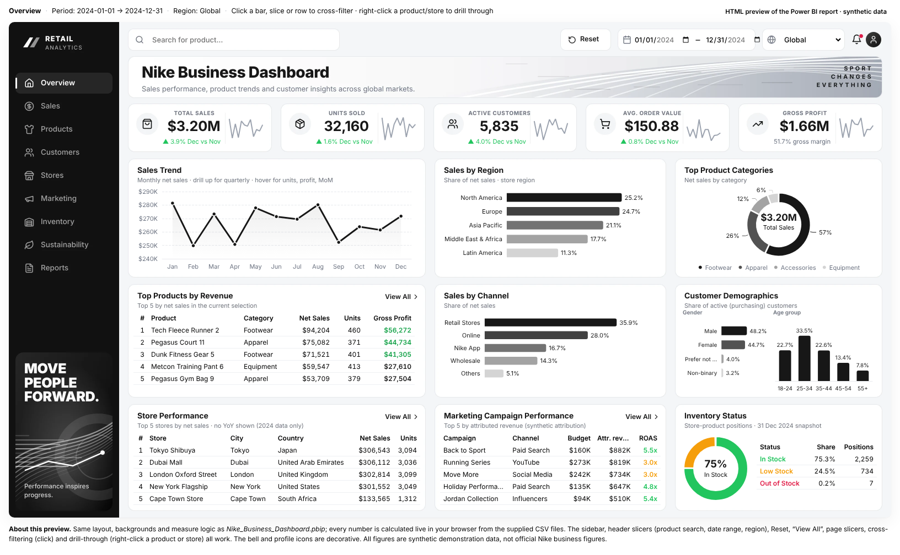

<div align="center">

# Nike Business Dashboard
### Retail Sales • Product Performance • Customer Insights • Business Intelligence

**A multi-page retail analytics portfolio project built with Power BI, DAX, Power Query, Python, and an interactive HTML dashboard preview.**

[Dashboard Preview](#-dashboard-screenshots) · [Features](#-key-features) · [Project Structure](#-project-structure) · [Run the Project](#-run-the-project)

</div>

> **Data disclaimer:** This project uses synthetic demonstration data. The records and business figures are not official Nike data. This is an independent portfolio project and is not affiliated with or endorsed by Nike.

---

## 📸 Dashboard Screenshots

The screenshots below are stored in this repository, so GitHub will render them directly on this page. Click a screenshot to view it at full size.

### 1. Overview Dashboard



*High-level KPIs and a consolidated view of retail sales, regions, product categories, channels, stores, campaigns, and inventory.*

<details>
<summary><strong>2. Sales Analysis</strong></summary>


*Monthly net sales and gross profit, month-over-month growth, channel contribution, and regional performance.*
</details>

<details>
<summary><strong>3. Product Performance</strong></summary>


*Category mix, sales by product line, gross margin by subcategory, and product rankings.*
</details>

<details>
<summary><strong>4. Customer Insights</strong></summary>


*Customer segments, loyalty tiers, gender and age profiles, and customer-country revenue.*
</details>

<details>
<summary><strong>5. Store Performance</strong></summary>


</details>

<details>
<summary><strong>6. Marketing Campaigns</strong></summary>


</details>

<details>
<summary><strong>7. Inventory Status</strong></summary>


</details>

<details>
<summary><strong>8. Sustainability</strong></summary>


</details>

<details>
<summary><strong>9. Reports</strong></summary>


</details>

<details>
<summary><strong>10. Product Details — Drill-through</strong></summary>


</details>

<details>
<summary><strong>11. Store Details — Drill-through</strong></summary>


</details>

---

## ✨ Key Features

- **11 report pages:** 9 main navigation pages and 2 drill-through detail pages.
- **Retail KPIs:** net sales, gross profit, gross margin, units sold, average order value, completed orders, and discount rate.
- **Sales analysis:** monthly trends, month-over-month growth, channel contribution, and regional performance.
- **Product analysis:** category mix, product-line performance, subcategory margins, and product ranking.
- **Customer analytics:** customer segments, loyalty tiers, demographics, and country-level revenue.
- **Operations insights:** store performance, inventory status, marketing campaigns, and sustainability metrics.
- **Interactive HTML preview:** dashboard navigation, filtering, charts, and drill-through-style detail views.
- **Data quality and QA scripts:** utilities and reports for validating the synthetic data and project structure.

## 🧰 Tools & Technologies

| Area | Technologies |
|---|---|
| Business intelligence | Microsoft Power BI Project (`.pbip`) |
| Data transformation | Power Query (M) |
| Analytics | DAX measures, data modeling, KPI analysis |
| Dataset | CSV files with synthetic retail records |
| Interactive preview | HTML, CSS, JavaScript, ECharts |
| Validation | Python scripts and automated QA checks |

## 📊 Dataset & Validation

- **Sales dataset:** 25,000 synthetic transaction records.
- **Report model:** documented as containing 150+ DAX measures.
- **Automated QA:** the project documentation records 240/240 checks passed.
- **Important testing note:** the documented checks cover static validation and browser-preview tests. The Power BI project still needs to be opened and verified in Power BI Desktop to confirm local data paths and Power BI-engine execution.

Read the supporting reports: [Data Quality Report](Documentation/Data_Quality_Report.md) · [QA Report](Documentation/QA_Report.md).

## 🗂️ Project Structure

```text
.
├── Data/                         # Synthetic CSV datasets and data dictionary
├── PowerBI/
│   ├── Nike_Business_Dashboard.pbip
│   ├── Nike_Business_Dashboard.Report/
│   ├── Nike_Business_Dashboard.SemanticModel/
│   ├── DAX_Measures.txt
│   ├── Power_Query_M_Code.txt
│   ├── Data_Model.md
│   ├── Dashboard_Layout.md
│   └── Design/
├── Dashboard_Preview/
│   ├── index.html                # Preview using the assets folder
│   ├── Nike_Dashboard_Preview_Standalone.html
│   └── assets/
├── Documentation/
│   ├── Screenshots/              # Dashboard screenshots shown above
│   ├── Data_Quality_Report.md
│   └── QA_Report.md
├── Scripts/                      # Build, validation, and QA scripts
├── START_HERE.txt
├── .gitignore
└── README.md
```

## 🚀 Run the Project

### Option A — Open the interactive HTML preview

**Quickest option; no Power BI installation is required.**

1. Open `Dashboard_Preview/Nike_Dashboard_Preview_Standalone.html` in a modern web browser.
2. Alternatively, open `Dashboard_Preview/index.html` and keep its `assets/` folder in the same directory structure.

### Option B — Open in Power BI Desktop

1. Use Windows with a recent version of Microsoft Power BI Desktop installed.
2. Open `PowerBI/Nike_Business_Dashboard.pbip`.
3. If Power Query cannot find the CSV files, review the source-folder paths and update them to point to this repository's `Data/` folder.
4. Refresh the data, then verify visuals, measures, and report pages in Power BI Desktop.
5. To create a `.pbix` copy after validating the project, use **File → Save as** in Power BI Desktop.

**Format note:** This repository includes a Power BI Project (`.pbip`), not a `.pbix` file.

## 💡 Business Questions This Dashboard Helps Explore

- Which regions and sales channels contribute most to net sales?
- Which product categories and product lines have the strongest sales and margins?
- How does sales performance change from month to month?
- Which customer segments and loyalty tiers contribute the most revenue?
- How do stores, campaigns, and inventory positions compare?

## ⚠️ Notes & Limitations

- All data is synthetic and intended for learning and portfolio demonstration only.
- This is an independent Nike-themed portfolio project, not an official Nike product.
- Validate data paths and report behavior locally in Power BI Desktop before describing the `.pbip` as fully tested in Power BI.

## 👤 Author

**Vishal Borse**  
Aspiring Data Analyst | Power BI · SQL · Python · Advanced Excel · Tableau

---

If you find this project useful, consider giving the repository a ⭐.
